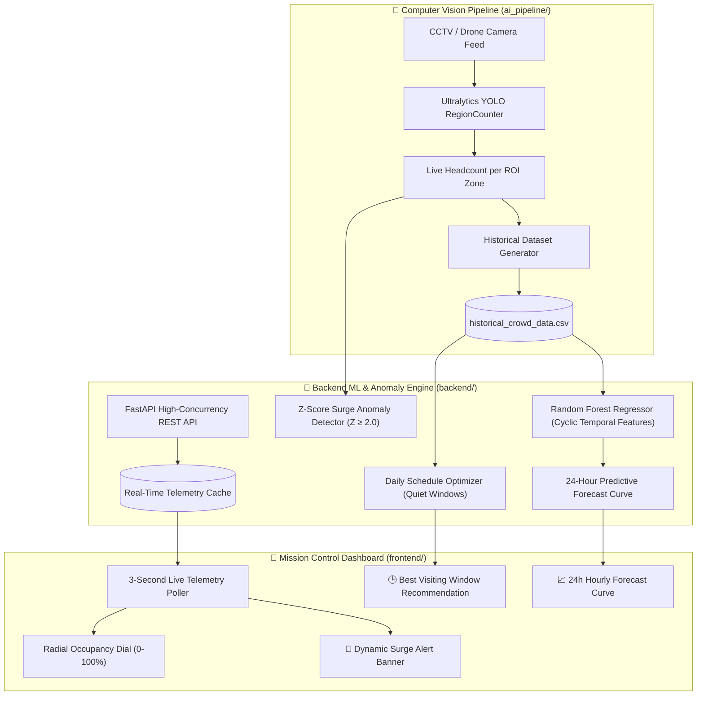

# 🛕 YatraSetu: AI Crowd Analytics & ML Anomaly Prediction Ecosystem

[](https://www.python.org/)
[](https://fastapi.tiangolo.com/)
[](https://docs.ultralytics.com/)
[](https://react.dev/)
[](https://scikit-learn.org/)
[](LICENSE)

**YatraSetu** is an end-to-end intelligent crowd management and public safety ecosystem designed for high-density pilgrimage destinations, heritage corridors, and mass gatherings. It combines **edge computer vision (YOLO headcount tracking)**, a **machine learning predictive forecasting pipeline**, **real-time Z-score surge anomaly detection**, and a **responsive command-center telemetry dashboard**.

---

## 🏛️ System Architecture



---

## ⚡ Key Features

* **Real-Time Video Analytics**: Integrates Ultralytics YOLO with Region-of-Interest (ROI) Polygon counters for continuous headcount telemetry across sanctum, queue, and entry zones.
* **ML Predictive Forecasting**: Random Forest Regressor trained on cyclic time-of-day and day-of-week embeddings to generate 24-hour predictive demand curves.
* **Statistical Surge Anomaly Detection**: Real-time Z-score monitoring ($Z \ge 2.0$) that instantly flags dangerous crowd surges, bottlenecks, or gate blockages.
* **Dynamic Best Window Optimizer**: Analyzes historical patterns to recommend optimal visiting hours, flattening peak stampede risks.
* **Mission Control Telemetry Dashboard**: Built with React, Vite, and Tailwind CSS, featuring radial occupancy dials, active surge banners, and historical graphs.

---

## 🚀 Quick Start Guide

### Prerequisites
- **Python 3.10+**
- **Node.js 18+** & npm
- Git

---

### Step 1: Clone the Repository
```bash
git clone https://github.com/tomkarrao-commits/Yatrasetu.git
cd Yatrasetu
```

---

### Step 2: Launch the Backend ML Engine

```bash
cd backend
pip install -r requirements.txt
python main.py
```
> The FastAPI backend will start at **`http://localhost:8000`** (Swagger docs at `http://localhost:8000/docs`).

---

### Step 3: Launch the Frontend Dashboard

Open a separate terminal:
```bash
cd frontend
npm install
npm run dev
```
> Access the mission control dashboard at **`http://localhost:5173`** (or `http://localhost:3000`).

---

## 📁 Repository Structure

```text
Yatrasetu/
├── ai_pipeline/                     # YOLO video inference & ROI headcount pipeline
├── backend/                         # FastAPI backend & ML forecasting service
│   ├── app/
│   │   ├── routes/crowd.py          # Real-time telemetry & anomaly endpoints
│   │   └── services/ml_engine.py    # Random Forest model & Z-Score anomaly detector
│   ├── requirements.txt             # Python ML & web dependencies
│   └── main.py                      # FastAPI application entrypoint
├── frontend/                        # React + Vite + Tailwind CSS dashboard
│   ├── src/
│   │   ├── components/              # Radial gauges, timeline charts, alert banners
│   │   └── App.jsx                  # Main mission control layout
│   └── package.json
├── data/                            # Sample camera feeds, GeoJSON & historical logs
├── DEPLOYMENT_GUIDE.md              # Cross-platform installation & verification guide
└── README.md                        # Project documentation
```

---

## 📜 License
This project is open-source and licensed under the [MIT License](LICENSE).
